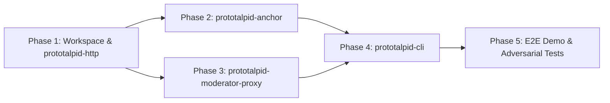

# Implementation Plan: `talpidian-e2e`

An end-to-end Rust proof-of-concept of **Moderation of unLinkable Endorsements (MOLE)** demonstrating privacy-preserving protection of origin web resources against excessive traffic, built on [`mole-p256-rs`](https://github.com/Moderation-of-unLinkable-Endorsements/mole-p256-rs), `hyper`, `clap`, `xdg`, and `rusqlite`.

---

## 1. Specification Synthesis & Architectural Strategy

### 1.1 Confirmed Architectural Decisions

- **Persistence**: `rusqlite` with WAL mode and `BEGIN IMMEDIATE` transactions for single-writer atomic nullifier, session-claim, and spend-state persistence.
- **Active MOLE Session Header**: Custom `Mole-Session: <token>` response/request header tying an active client session to a held credential at `prototalpid-moderator-proxy` (stripped before proxying upstream). Standard HTTP cookies remain persisted in `prototalpid-cli`'s SQLite cookie jar for Anchor trust sessions and upstream origin cookies.
- **Configuration Discovery**: Fixed well-known HTTPS endpoints (`/.well-known/mole-anchor` and `/.well-known/mole-moderator`) serving the `draft-jms-mole-protocols` §6 JSON schemas directly, without extra CLI config-override plumbing.
- **Deferred Credential Moderation (`held-for-update` + `signoff` / `recovery`)**: Presentations escrow `spend_amount` (`s`) credits while the Moderator observes session behavior under `Mole-Session` and returns `Mole-Credential: held-for-update-0001="<seconds>"`. Behavior-adjusted refunds (`0 <= t <= s + a`) or revocations (`NoUpdate` / `update-0001=""`) are delivered when the Client submits `signoff-0001` (before hold expiry, including after an early `401` session revocation) or `recovery-0001` (after hold expiry).

### 1.2 Maturity-Driven Isolation

Per [README.md](README.md#L13-L25), less mature specifications are isolated behind clean module boundaries so spec churn stays localized:

| Maturity Tier | Specifications | Stability Strategy in `talpidian-e2e` |
|---|---|---|
| **Mature** | `draft-jms-mole-architecture`, `draft-ladd-mole-ec-ihat`, `draft-schlesinger-mole-ec-act` (`mole-p256-rs` crates `ec-ihat` & `ec-act`) | Used directly via `mole-p256-rs` (`rustcrypto` + `std` default features) with strict enforcement of single-use state, `Zeroizing` secret buffers, and atomic nullifier/tombstone stores. |
| **Active Development** | `draft-jms-mole-protocols`, `draft-jms-mole-http-transport`, `draft-authors-mole-vole-ihat` | Confined to discrete modules in `prototalpid-http` (`transport`, `wire`, `config`, `schemes`). Storage columns use variable-length `BLOB`s and multi-step grant traits so large post-quantum keys/proofs (e.g., VOLE-IHAT's 45.5 KB keys and 2-move grants) can be added without schema or HTTP parser changes. |
| **Concept Phase** | `web-drafts/explainer.md` (`Want-Endorsement`, `Mole-Session` clearance, `held-for-update` / `signoff` session scoring) | Confined to session/policy modules in `prototalpid-cli`, `prototalpid-anchor`, and `prototalpid-moderator-proxy`. |

> [!NOTE]
> Line 18 of [README.md](README.md#L18) currently links **EC-ACT** to `draft-ladd-mole-ec-ihat.html` rather than `draft-schlesinger-mole-ec-act.html`. Phase 1 includes a one-line fix when implementation starts.

### 1.3 Key Protocol & `mole-p256-rs` Integration Details

1. **Fixed EC-IHAT Redemption Context (`draft-jms-mole-protocols` §4.4.1)**:
   - `ctx_red` is fixed to `b"MOLE-EC-IHAT-ctx_red-v1"` across all Moderators so Clients obtain Endorsements prior to knowing which Moderator they will visit; Moderator challenge binding uses `challenge_digest = SHA-256(RedemptionChallenge)`.
2. **EC-ACT Context & Key ID Derivation (`draft-jms-mole-protocols` §5.2.1–5.2.3)**:
   - `key_id = SHA-256(SerializeElement(pkM))` (32 bytes); `truncated_key_id = key_id[31]`.
   - `ctx_cred = credential_context || I2OSP(L, 1)`.
   - `ctx_spend = SHA-256(credential_challenge)` over raw decoded `Challenge` octets.
3. **Deferred `IssueRefund` with `ec_act::VerifiedSpend`**:
   - In `mole-p256-rs`, `ec_act::issue_refund` requires an unconstructible, borrowed `VerifiedSpend<'a>` produced by `ec_act::verify_spend`, while `signoff-0001` and `recovery-0001` carry only the 96-byte `recovery-handle` (`key_id[32] || SerializeScalar(spend.k)[32] || SHA-256(PresentationAndUpdate)[32]`).
   - When `prototalpid-moderator-proxy` accepts a fresh presentation and returns `held-for-update-0001="<secs>"`, it runs `ec_act::verify_spend` immediately, records the nullifier atomically, and persists `(spend_bytes, ctx_spend)` while `state = 'held'`.
   - When the hold concludes—via `signoff-0001`, early rate-limit invalidation, or a background hold-expiry task at `held_until`—the Moderator computes `t` from session metrics, reconstructs `VerifiedSpend` from its own trusted `(spend_bytes, ctx_spend)` to call `ec_act::issue_refund(verified, t)` (or records `NoUpdate`), stores the fixed `refund_bytes`, and wipes `spend_bytes`. Subsequent `recovery-0001` requests simply read the finalized `refund_bytes` from SQLite without running any proof verification (`draft-jms-mole-http-transport` §5.4).
4. **`held-for-update-T` Payload Syntax (`draft-jms-mole-http-transport` §5.3)**:
   - Unlike `response-T` and `update-T` (which carry canonical unpadded base64url bytes), `held-for-update-0001="<time>"` carries an ASCII decimal duration in seconds (`u64`), parsed cleanly in `prototalpid_http::transport`.
5. **Grant Endpoint Step Disambiguation (`draft-jms-mole-http-transport` §5.1 & `draft-jms-mole-protocols` §4.4.2)**:
   - Both EC-IHAT grant POSTs hit `grant-uri` with `Content-Type: application/mole-endorsement-request; type=0002` and no outer wrapper. `GrantRequest` (`uint16 count`, `count >= 1`) is always 2 bytes; `GrantChallenges` (`session_id[32]` + `challenges<V>`) is `>= 65` bytes.
6. **Anchor `AnchorState` Replay Protection (`draft-ladd-mole-ec-ihat` §5.3)**:
   - Calling `ec_ihat::respond` twice on the same `AnchorState` leaks `skA`. `prototalpid-anchor` AEAD-encrypts `AnchorState` batches under AAD `session_id` and atomically claims-and-nullifies the ciphertext (`BEGIN IMMEDIATE`) before calling `ec_ihat::respond`, retaining a tombstone until expiry.

---

## 2. Workspace Layout & Dependencies

```text
talpidian-e2e/
├── Cargo.toml                        # Workspace (edition = "2024", resolver = "3")
├── crates/
│   ├── prototalpid-http/             # MOLE HTTP transport, wire codecs, configs, scheme traits
│   ├── prototalpid-cli/              # curl-subset MOLE CLI client + XDG SQLite wallet/cookie jar
│   ├── prototalpid-anchor/           # HTTPS Anchor service (PoW & prompt challenges + EC-IHAT grant)
│   └── prototalpid-moderator-proxy/  # HTTPS Moderator reverse proxy (Mole-Session + held-for-update)
└── tests/ (or workspace e2e harness) # Multi-anchor + proxy + upstream origin E2E scenarios
```

### Dependencies

- **Crypto**: `ec-ihat`, `ec-act`, `mole-p256` (`git = "https://github.com/Moderation-of-unLinkable-Endorsements/mole-p256-rs"`, default `rustcrypto` + `std`).
- **HTTP & TLS**: `hyper` (v1, `http1`/`http2`, `client`/`server`), `hyper-util`, `http-body-util`, `http`, `tokio`, `tokio-rustls`, `rustls`, `rcgen` (ephemeral local CA/cert generation for E2E runs alongside custom PEM support).
- **CLI & Paths**: `clap` (v4, `derive`), `xdg` (`3.0`).
- **Persistence**: `rusqlite` (linking host `libsqlite3` `3.51.2`, with optional `bundled` feature).
- **Utilities**: `serde`, `serde_json`, `base64`, `sha2`, `chacha20poly1305` (Anchor state AEAD), `url`.

---

## 3. Component Design

```mermaid
sequenceDiagram
    participant CLI as "prototalpid-cli (Client)"
    participant Anc as "prototalpid-anchor (Anchor 1..N)"
    participant Mod as "prototalpid-moderator-proxy"
    participant Up as "Protected Origin Server"

    Note over CLI,Anc: 1. Trust Establishment & Proactive Endorsement Grant
    CLI->>Anc: GET /challenge (Want-Endorsement: Mole)
    Anc-->>CLI: 200 PoW or Interactive Prompt Challenge
    CLI->>Anc: POST /challenge (PoW nonce or prompt answer)
    Anc-->>CLI: 200 OK + Set-Cookie: anchor_session + WWW-Authenticate: Mole endorse-0002=""
    CLI->>Anc: POST /mole/grant (GrantRequest: count)
    Anc-->>CLI: 200 OK (GrantCommitments: session_id + commitments)
    CLI->>Anc: POST /mole/grant (GrantChallenges: session_id + challenges)
    Anc-->>CLI: 200 OK (GrantResponses: responses)
    Note over CLI: Finalize & store EC-IHAT Endorsements in SQLite

    Note over CLI,Up: 2. First Visit: Challenge, Redeem & Issue, Present (Escrow Deposit s)
    CLI->>Mod: GET /resource (no Mole-Session)
    Mod-->>CLI: 401 + WWW-Authenticate: Mole challenge-0001="...", Mole redeem-0002="..."
    CLI->>Mod: GET /.well-known/mole-moderator (if not cached)
    Mod-->>CLI: 200 JSON ModeratorConfiguration
    CLI->>Mod: POST /mole/issue (Authorization: Mole redeem-0002="...", credential-request-0001="...")
    Mod-->>CLI: 200 OK + Mole-Credential: response-0001="..."
    Note over CLI: FinalizeIssue (balance = c_init); persist SpendState & recovery_handle
    CLI->>Mod: GET /resource (Authorization: Mole presentation-0001="...")
    Mod->>Up: GET /resource
    Up-->>Mod: 200 OK (body)
    Mod-->>CLI: 200 OK + Mole-Session: <token> + Mole-Credential: held-for-update-0001="30"

    Note over CLI,Up: 3a. Polite Session -> Signoff (or Recovery after 30s) -> Full Refund
    CLI->>Mod: GET /resource (Mole-Session: <token>)
    Mod->>Up: GET /resource (within session rate limit)
    Up-->>Mod: 200 OK
    Mod-->>CLI: 200 OK
    CLI->>Mod: POST /mole/issue (Authorization: Mole signoff-0001="<recovery-handle>")
    Mod-->>CLI: 200 OK + Mole-Credential: update-0001="<refund t=s>"
    Note over CLI: FinalizeRefund (balance restored: c - s + s = c)

    Note over CLI,Up: 3b. Excessive Traffic -> Session Invalidated -> Penalized Refund / NoUpdate
    CLI->>Mod: Flood GET /resource (Mole-Session: <token>)
    Note over Mod: Rate limit breached! Invalidate Mole-Session; finalize verdict t=0 (or NoUpdate)
    Mod-->>CLI: 401 + WWW-Authenticate: Mole challenge-0001="..."
    CLI->>Mod: POST /mole/issue (Authorization: Mole signoff-0001="<recovery-handle>")
    Mod-->>CLI: 200 OK + Mole-Credential: update-0001="<t=0 or empty NoUpdate>"
    Note over CLI: Deposit forfeited (or chain terminated); repeated floods exhaust credits & block client
```

### 3.1 `prototalpid-http` (Library Crate)

1. **`transport` (`draft-jms-mole-http-transport` + `Mole-Session`)**:
   - RFC 9110 §11.2 / §11.6.1 `Mole` auth-scheme parser & serializer:
     - `WWW-Authenticate`: `endorse-T`, `redeem-T`, `challenge-T` (multiple challenges per header or across headers).
     - `Authorization`: `redeem-E` + `credential-request-C` (either order; `redeem-0001=""` quoted), `presentation-T`, `recovery-T`, `signoff-T`.
     - `Mole-Credential`: `response-T` (base64url), `update-T` (base64url, or `""` -> `NoUpdate`), `held-for-update-T` (ASCII `u64` seconds).
     - Header constants & parsers for `Mole-Session` and `Want-Endorsement: Mole`.
   - Strict validation: canonical unpadded base64url, exact 4-hex-digit `-T` suffix rules (`0000` invalid; malformed prefixes rejected as `400`; unknown non-prefix params like `realm` ignored; duplicate params and mixed operations rejected).
   - Media-type parser/formatter for `application/mole-endorsement-{request,response}; type=XXXX`.
   - Response header helpers enforcing `Cache-Control: no-store` with `Mole-Credential` and exposing `WWW-Authenticate, Mole-Credential, Mole-Session` under CORS.

2. **`wire` (`draft-jms-mole-protocols` Binary Payloads)**:
   - Minimal-encoding QUIC varint (`<V>`, RFC 9000 §16) codec rejecting non-shortest encodings and trailing bytes.
   - Codecs for `GrantRequest`, `GrantCommitments`, `GrantChallenges`, `GrantResponses`, `RedemptionChallenge` (+ `SHA-256` digest), `EcActIssuanceRequest`, `EcActIssuanceResponse`, `EcActChallenge` (+ `SHA-256` `ctx_spend`), `EcActPresentationAndUpdate`, `EcActUpdate`, and 96-byte `RecoveryHandle`.

3. **`config` (`draft-jms-mole-protocols` §6)**:
   - `AnchorConfiguration` and `ModeratorConfiguration` serde models (unpadded base64url `bstr` fields, ordered `anchor-set`) and `/.well-known/mole-{anchor,moderator}` URI helpers.

4. **`schemes` (Protocol Registry & Greasing)**:
   - Endorsement types `0x0001` (`NO_ENDORSEMENT`), `0x0002` (`EC_IHAT`); Credential type `0x0001` (`EC_ACT`); greased type helpers (`0x0A0A..0xFAFA`).
   - Traits/adapters binding `ec_ihat` (`ctx_red = b"MOLE-EC-IHAT-ctx_red-v1"`) and `ec_act` (`ctx_cred = credential_context || I2OSP(L, 1)`).

---

### 3.2 `prototalpid-cli` (Binary Crate)

A `curl`-subset HTTPS client managing endorsements, credentials, held-session lifecycles, and cookies in SQLite.

#### CLI Interface (`clap`)
- **`curl`-subset flags**:
  - `<URL>...` (supports one or multiple URLs sequentially), `-X/--request`, `-H/--header`, `-d/--data`, `--data-binary`
  - `-i/--include`, `-I/--head`, `-v/--verbose` (HTTP + MOLE state trace to `stderr`), `-s/--silent`, `-S/--show-error`, `-o/--output`, `-f/--fail`, `-w/--write-out`
  - `-L/--location` (never auto-redirects stateful grant `POST`s per `draft-jms-mole-http-transport` §5.1)
  - `-b/--cookie`, `-c/--cookie-jar`, `-k/--insecure`, `--cacert <PEM>`
- **MOLE flags**:
  - `--mole-store <FILE>`: Override default XDG path (`$XDG_DATA_HOME/prototalpid/state.db`, `0600` permissions).
  - `--mole-disable`: Bypass MOLE logic (plain HTTP/cookie client for A/B demo comparisons).
  - `--mole-endorse` / `--mole-batch-count <N>`: Send `Want-Endorsement: Mole`, solve Anchor PoW or prompt user on `tty`, and run the 2-step EC-IHAT batch grant.
  - `--mole-signoff <ORIGIN_OR_URL>` / `--mole-signoff-on-exit`: Explicitly send `signoff-0001` for an active held session (or sign off automatically when the CLI invocation exits).
  - `--mole-status`: Display stored endorsements, usable/held credentials, active `Mole-Session`s, and cookies.

#### Persistence & Held-Session Lifecycle (`rusqlite`)
- **Tables**:
  - `cookies`: Standard origin/domain/path/expiry/secure cookie jar.
  - `anchor_configs` & `moderator_configs`: Cached `.well-known` JSON configs + anchor-set history for consistency checks.
  - `endorsements`: Keyed by `(anchor_origin, endorsement_type, ctx_iss)`; atomically burned *before* sending a `Redemption`.
  - `credentials`: Keyed by `(moderator_origin, credential_type, key_id, credential_context)`; tracks `usable` vs. `held_or_pending` status, context cooldown locks, and presentation counts.
  - `pending_spends`: Stores `spend_state_bytes`, `presentation_bytes`, `recovery_handle` (96B), `state` (`in_flight` | `held`), `session_token` (from `Mole-Session`), `held_until`, and original request metadata.
- **Request State Machine**:
  1. **Pre-flight Held/Pending Check** for target origin:
     - If a `pending_spends` entry is `in_flight` (interrupted network call) or `held` with `now >= held_until`: send `POST <issuance-uri>` with `Authorization: Mole recovery-0001="<handle>"` (`200` -> `FinalizeRefund` or `NoUpdate`; `404` -> discard) and clear any expired `session_token`.
     - If `held` and within a small lead margin of `held_until` (e.g., `< 2s` remaining): proactively send `signoff-0001` before `held_until` (`draft-jms-mole-http-transport` §5.3 SHOULD), finalize the updated Credential, and proceed cleanly.
     - If `held` and `now < held_until`: attach `Mole-Session: <session_token>` to the outbound request!
  2. **Response Handling**:
     - Persist any `Set-Cookie` headers; process any `Mole-Credential` header on all status codes.
     - On `200` with optional `WWW-Authenticate: Mole challenge-0001`: apply greasing rules (`draft-jms-mole-protocols` §3.2).
     - On `401` with `WWW-Authenticate: Mole ...`:
       - **If a `held` session existed for this Moderator** (early session invalidation / step-up!): clear `session_token`, immediately send `POST <issuance-uri>` with `Authorization: Mole signoff-0001="<handle>"` (or `recovery-0001` if `now >= held_until`) to settle the held credential (`FinalizeRefund` or `NoUpdate`), then continue to answer the `401` challenge.
       - Fetch/load `ModeratorConfiguration` from `/.well-known/mole-moderator`.
       - If no `usable` Credential covers `spend_amount`: select a stored `Endorsement` matching `anchor-set` & `issuance-epoch`, burn it in SQLite, `POST` `redeem-0002` + `credential-request-0001` to `issuance-uri`, and `FinalizeIssue`.
       - Run `ProveSpend`, durably commit `pending_spends` (`in_flight`), resend the protected request with `Authorization: Mole presentation-0001="..."`, and record either `held-for-update-0001` + `Mole-Session` (`state = 'held'`) or an immediate `update-0001` (`FinalizeRefund` / `NoUpdate`).
  3. **Optional Post-flight Signoff**: If `--mole-signoff-on-exit` is passed, send `signoff-0001` and finalize the refund before process exit.

---

### 3.3 `prototalpid-anchor` (Binary + Library Crate)

An HTTPS Anchor service issuing scarce EC-IHAT Endorsements after PoW or interactive challenge verification.

- **State (`rusqlite`)**: Persisted 48-byte `SecretKey` seed + derived `ChaCha20Poly1305` `AnchorState` encryption key, `challenges`, `anchor_sessions` (cookie token + per-epoch endorsement quota), and `grant_sessions` (`session_id`, `state_ciphertext`, `count`, `consumed` tombstone, `expires_at`).
- **Endpoints**:
  1. `GET /.well-known/mole-anchor`: Serves `AnchorConfiguration` JSON.
  2. `GET /challenge` & `POST /challenge`:
     - Supports `--challenge-mode <pow|prompt|both>`:
       - `pow`: SHA-256 leading-zero-bits puzzle (`--pow-bits`).
       - `prompt`: Single-use arithmetic/text challenge stored in SQLite for interactive `tty` answering.
     - Valid solution sets `Set-Cookie: anchor_session=<token>; Secure; HttpOnly; SameSite=Lax` with `--quota-per-challenge` endorsements and includes `WWW-Authenticate: Mole endorse-0002=""` when `Want-Endorsement: Mole` is present (returning `429` when quota is exhausted).
  3. `POST /mole/grant`:
     - Step 1 (`GrantRequest`): Validates `anchor_session`, deducts `n = min(count, remaining_quota)`, runs `ec_ihat::commit(ctx_iss)` `n` times, AEAD-encrypts states under `session_id`, and returns `GrantCommitments`.
     - Step 2 (`GrantChallenges`): Atomically sets `consumed = 1, state_ciphertext = NULL` inside `BEGIN IMMEDIATE` before decrypting and calling `ec_ihat::respond`, returning `GrantResponses`.

---

### 3.4 `prototalpid-moderator-proxy` (Binary + Library Crate)

An HTTPS reverse proxy implementing `Mole-Session` gating, EC-IHAT redemption, and `held-for-update` EC-ACT session-deposit moderation.

- **State (`rusqlite`)**:
  - `moderator_keys`: Persisted 48-byte `SecretKey` seed, `balance_width` `L` (default `8`), `credential_context`, `result_retention_secs`.
  - `redeemed_endorsements (ctx_iss BLOB, nullifier BLOB, redeemed_at INTEGER, PRIMARY KEY (ctx_iss, nullifier))`
  - `spent_credentials (key_id BLOB, ctx_cred BLOB, nullifier BLOB, presentation_sha256 BLOB, state TEXT, spend_bytes BLOB, ctx_spend BLOB, outcome_type TEXT, refund_bytes BLOB, held_until INTEGER, result_expires_at INTEGER, PRIMARY KEY (key_id, ctx_cred, nullifier))`
  - `mole_sessions (session_token TEXT PRIMARY KEY, key_id BLOB, ctx_cred BLOB, nullifier BLOB, active INTEGER, request_count INTEGER, window_started_at INTEGER, window_hits INTEGER, penalty_credits INTEGER, revoke_chain INTEGER, expires_at INTEGER)`
- **Background Hold-Expiry Finalizer**:
  - A periodic Tokio task (e.g., every 1s) queries `spent_credentials WHERE state = 'held' AND held_until <= now`, invalidates the corresponding `mole_sessions` row, computes `t = s.saturating_sub(penalty_credits)` (or `NoUpdate` if `revoke_chain == 1`), signs `RefundMessage` via `ec_act::verify_spend` + `ec_act::issue_refund`, stores `refund_bytes`, clears `spend_bytes`, and sets `state = 'finalized'` (also lazily triggered if `recovery-0001` arrives right at `held_until`).
- **Local Moderator Endpoints**:
  - `GET /.well-known/mole-moderator`: Serves `ModeratorConfiguration` JSON (discovering or loading trusted Anchor public keys in fixed `anchor-set` order).
  - `POST /mole/issue`:
    - `RedeemAndIssue`: Verifies `truncated_key_id`, `credential_context`, `ec_act::verify_issue_request`, time-windowed HMAC `RedemptionChallenge`, and `ec_ihat::verify_redemption`; atomically inserts `(ctx_iss, nf)` and returns `200 OK` + `Mole-Credential: response-0001="..."` (`initial_balance`, e.g. `60`).
    - `Signoff` (`signoff-0001="<handle>"`): If `state == 'held'`, atomically invalidates `mole_sessions`, finalizes `RefundMessage` (or `NoUpdate`) from observed session behavior, transitions `spent_credentials` to `'finalized'`, and returns `200 OK` + `Mole-Credential: update-0001="..."` (idempotently returning the retained update if already finalized and within `result_expires_at`, else `404`).
    - `Recovery` (`recovery-0001="<handle>"`): Never verifies a client proof or runs upstream operations; if `state == 'finalized'` (after `held_until` or prior signoff) and `now < result_expires_at`, returns `200 OK` + `Mole-Credential: update-0001="..."`, else `404` (if called prematurely while still `'held'` before `held_until`, returns `404` without altering the held session per §5.3–5.4).
- **Reverse-Proxy Moderation & Session-Deposit Policy**:
  - **Requests with `Mole-Session: <token>`**:
    - Looks up active, unexpired session in `mole_sessions`.
    - Updates sliding-window request rate & cost counters:
      - **Within policy limits**: strips `Mole-Session`, forwards request to upstream via `hyper`, returns upstream response.
      - **Rate limit / burst threshold exceeded**: sets `penalty_credits = s` (or `revoke_chain = 1` on severe flood), invalidates `mole_sessions` (`active = 0`), immediately finalizes the held spend in `spent_credentials`, and returns `401 Unauthorized` + `WWW-Authenticate: Mole challenge-0001="...", Mole redeem-0002="..."` without hitting the upstream origin!
  - **Requests with `Authorization: Mole presentation-0001="..."`**:
    - Duplicate `(key_id, ctx_cred, spend.k)` with matching `presentation_sha256` -> `409 Conflict` (carrying `held-for-update-0001` if still held or `update-0001` if finalized, no upstream call); conflicting/expired -> `401`.
    - Fresh valid `ec_act::verify_spend` (escrowing deposit `s`, e.g. `20`): atomically inserts `'held'` record + active `mole_sessions` token (`held_until = now + hold_secs`), forwards request to upstream, and returns upstream response with `Mole-Session: <token>`, `Mole-Credential: held-for-update-0001="<hold_secs>"`, and `Cache-Control: no-store`.
  - **Unauthenticated Requests (no valid `Mole-Session` and no `Authorization: Mole`)**:
    - Immediately challenged with `401 Unauthorized` + `WWW-Authenticate: Mole challenge-0001="...", Mole redeem-0002="..."`.

---

## 4. Phased Implementation Roadmap



### Phase 1: Workspace Scaffolding & `prototalpid-http`
- Create root Cargo workspace (`edition = "2024"`, `resolver = "3"`) with `mole-p256-rs` git dependency and fix the EC-ACT URL typo in [README.md](README.md#L18).
- Implement `prototalpid-http` (`transport`, `wire`, `config`, `schemes`), including `Mole-Session`, `held-for-update-T`, `signoff-T`, `recovery-T`, QUIC `<V>` framing, and `draft-jms-mole-protocols` test-vector & malformed-input unit tests.

### Phase 2: `prototalpid-anchor`
- Implement `rusqlite` schema, AEAD `AnchorState` encryption, atomic `BEGIN IMMEDIATE` tombstone claim, PoW + prompt challenges, and `hyper` + `tokio-rustls` HTTPS server (`/.well-known/mole-anchor`, `/challenge`, `/mole/grant`).
- Integration tests covering PoW/prompt sessions, batch grants, `429` quota exhaustion, and concurrent `GrantChallenges` replay safety.

### Phase 3: `prototalpid-moderator-proxy`
- Implement `rusqlite` schema, stateless HMAC challenge binding, multi-Anchor EC-IHAT verification, `Mole-Session` sliding-window rate limiter, `held-for-update` escrow + `signoff-0001` + background hold-expiry finalizer + `recovery-0001`, and `hyper` HTTPS reverse proxy.
- Integration tests covering multi-Anchor issuer hiding (`N >= 3`), `Mole-Session` fast-path, polite `signoff-0001` full refund, rate-limit violation early `401` + forfeited deposit / `NoUpdate` revocation, `409` duplicate presentations, and post-expiry `recovery-0001`.

### Phase 4: `prototalpid-cli`
- Implement XDG `rusqlite` store (`0600` permissions), `curl`-subset `clap` CLI, `hyper` + `rustls` client, cookie jar, `Mole-Session` attachment, proactive `signoff-0001` / post-expiry `recovery-0001`, and early-`401` signoff-then-re-present flow.
- Integration tests covering multi-invocation `Mole-Session` reuse, `--mole-signoff`, hold-expiry recovery, and dropped-response recovery.

### Phase 5: End-to-End Traffic-Protection Demo & Verification Suite
- Build an automated workspace E2E suite (plus runnable demo harness) orchestrating **3 `prototalpid-anchor` instances**, **1 `prototalpid-moderator-proxy`**, **1 upstream HTTP server**, and **`prototalpid-cli`** across four scenarios:
  1. **Unendorsed client (`--mole-disable`)**: Blocked with `401` (zero upstream hits).
  2. **Polite endorsed client**: Acquires EC-IHAT Endorsements from Anchor 2 of 3, redeems for EC-ACT Credential, receives `Mole-Session` + `held-for-update-0001`, makes normal requests over `Mole-Session`, signs off (`signoff-0001`) to receive full deposit refund, and continues seamlessly across subsequent sessions.
  3. **Excessive traffic / scraper**: Floods requests over `Mole-Session` -> trips proxy rate limit -> session invalidated (`401`) -> `signoff-0001` returns penalized `t = 0` (or `NoUpdate`) -> escrowed credits rapidly hit zero and further access is denied once scarce Endorsements are spent.
  4. **Hold expiry & crash recovery**: Session left idle past `held_until` (or response dropped) recovers updated Credential cleanly via `recovery-0001` without re-triggering upstream operations.
